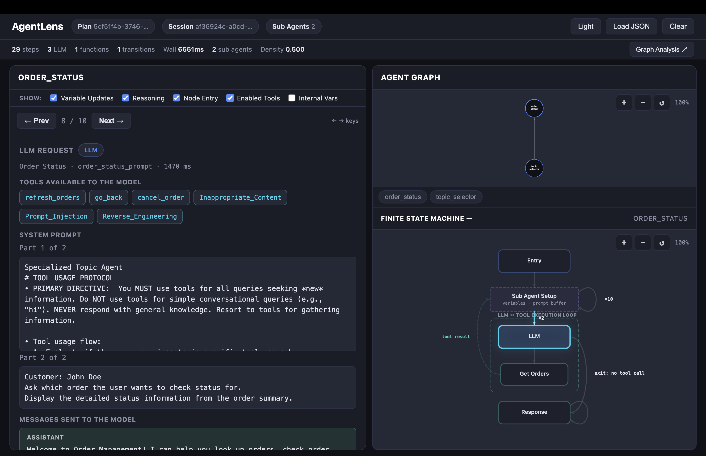

# AgentLens

Understand what your Agentforce agent actually did — visually.

📝 **Blog:** [AgentLens: Debug Agentforce with Interactive Visualizations](https://developer.salesforce.com/blogs/2026/05/agentlens-debug-agentforce-with-interactive-visualizations)



## Watch the Demo

[](https://www.youtube.com/watch?v=TZxVNKrx4mU)

## What it does

Load a trace from the **Agentforce DX** extension, the **NGA builder**, or the **SF CLI** and AgentLens shows you:

- **Agent Graph** — which sub agents talked to each other, how many times, and in what order
- **Finite State Machine** — the internal orchestration flow for each sub agent: LLM calls, tool executions, variable mutations, and handoffs
- **Step-by-Step Inspector** — walk through every event with full detail: system prompts, model output, tool inputs/outputs, and variable diffs
- **Graph Analysis Report** — one-click PDF with degree distribution, connectivity analysis, betweenness centrality, and algorithm explanations

## Getting a Trace

AgentLens accepts trace JSON from any of these sources:

| Source | How to get the trace |
|--------|---------------------|
| **Agentforce Builder** | Open your agent in Setup > Agentforce Builder, run a conversation in the Preview panel, then copy the JSON trace from the conversation details |
| **SF CLI — Agent Preview** | `sf agent preview -o <org>` — after the conversation, save the transcript JSON (saved to `./temp/agent-preview` by default, or specify `--output-dir`) |
| **Agentforce DX Extension** | Use the trace viewer in the Agentforce DX VS Code extension and copy the plan response JSON |

## Quick Start

### Chrome Extension

**Install from the Chrome Web Store:** [AgentLens](https://chromewebstore.google.com/detail/agentlens/gnlkpnbodhkjaamddkbhgobkgepnjgpa)

Once installed:

1. Navigate to the NGA builder in your Salesforce org
2. Click **Copy Code** to copy the trace, then click the **Open in AgentLens** button that appears next to it
3. A new tab opens with the full trace visualization

The extension injects a button directly into the NGA builder UI for one-click trace viewing.

**Install from source (for development):**

1. Open `chrome://extensions` and enable **Developer mode**
2. Click **Load unpacked** and select the `chrome-extension/` folder

### VS Code Extension

**Install from the Marketplace:** [AgentLens Visualizer](https://marketplace.visualstudio.com/items?itemName=MohithShrivastava.agentlens-viewer)

Or search for **AgentLens Visualizer** in the VS Code Extensions panel (`Cmd+Shift+X`).

The extension provides the same visualization inside VS Code with native theme integration — right-click any trace JSON file and select **Open with AgentLens**.

### Claude Code Plugin

Install the plugin in Claude Code:

```
/plugin install agentlens --marketplace forcedotcom/AgentLens
```

Inside a Salesforce DX project, say **"open AgentLens"** or **"visualize this in AgentLens"**. The plugin picks the right trace from your `sf agent preview` sessions and opens it in the AgentLens web app in your browser. You can be specific: name an agent ("show OrderManagement in AgentLens"), or point at one exchange ("the part where I searched for hotels").

The Salesforce CLI writes one trace per agent reply to `<project>/.sfdx/agents/<Agent>/sessions/<sessionId>/traces/<planId>.json`. The plugin picks from those files like this:

- It opens the newest session (by its `metadata.json` start time) that has a trace.
- In that session it opens the last non-empty turn.
- It skips greeting-only sessions and empty traces, and tells you when it does.

It also reads sessions saved with `--output-dir` and the older `.sfdx/agents/<Agent>.agent/traces/` layout. See [`agentlens-plugin/skills/open-agentlens/SKILL.md`](agentlens-plugin/skills/open-agentlens/SKILL.md) for details.

The plugin's eval suite lives in `agentlens-plugin/evals/`. Run it with `cd agentlens-plugin && claude plugin eval . --scaffold --allow-tools Bash`.

## Using the Claude Code Plugin Headlessly

You can install and run the plugin from a shell, a script, or CI, with no interactive Claude Code session.

### Install

Install from the AgentLens marketplace in one command:

```bash
claude plugin install agentlens --marketplace forcedotcom/AgentLens
```

Add `--scope project` to record the plugin in the project's `.claude/settings.json`, so everyone working in that DX project gets it.

Or skip installing and load the plugin from a local checkout of this repo for each run:

```bash
git clone https://github.com/forcedotcom/AgentLens.git
claude -p "open agentlens" --plugin-dir ./AgentLens/agentlens-plugin
```

### Run

Run `claude -p` from inside your Salesforce DX project. In headless mode nobody is there to approve tool calls, so pre-allow the tools the skill uses:

```bash
cd my-dx-project
claude -p "open agentlens" \
  --allowedTools "Skill" "Bash(node:*)" "Read" "Glob" "Grep"
```

The prompt works the same way it does interactively:

```bash
# A specific agent
claude -p "visualize the OrderManagement agent in AgentLens" --allowedTools "Skill" "Bash(node:*)" "Read" "Glob" "Grep"

# A specific exchange
claude -p "open the turn where I searched for hotels in Chicago in AgentLens" --allowedTools "Skill" "Bash(node:*)" "Read" "Glob" "Grep"
```

Claude opens the trace in your default browser and replies with what it opened: agent, session, turn, the user message for that turn, and any warnings. Add `--output-format json` to get a JSON result, and read the reply from `.result`.

### Preview, then visualize

Run a programmatic preview session, then open exactly that session by its ID:

```bash
SID=$(sf agent preview start --authoring-bundle MyAgent --simulate-actions --json | jq -r .result.sessionId)
sf agent preview send --authoring-bundle MyAgent --session-id "$SID" -u "Where is my order?" --json
sf agent preview end  --authoring-bundle MyAgent --session-id "$SID" --json

claude -p "open session $SID in agentlens" --allowedTools "Skill" "Bash(node:*)" "Read" "Glob" "Grep"
```

### Without Claude (CI, or no browser)

The skill's trace picker is a standalone Node 18+ script with no dependencies, so you can call it directly. With `--no-open` it writes a self-contained AgentLens HTML page that works offline, for example to save as a CI artifact:

```bash
node ./AgentLens/agentlens-plugin/skills/open-agentlens/scripts/open-agentlens.mjs \
  --agent MyAgent --no-open --out agentlens-trace.html
```

Useful options:

- `--list` prints every session and turn as JSON.
- `--session <id>`, `--turn <n>` and `--plan <planId>` pick a specific trace.
- `--help` lists all options.

The script prints the selection as JSON. It exits with code 2 when it finds no matching trace, and the message lists what it did find.

The script needs the AgentLens app (`index.html`). If it runs from a checkout of this repo, it uses that checkout's `index.html`. Otherwise it downloads `index.html` from GitHub and caches it in `~/.cache/agentlens/`. On offline machines, pass `--app <path/to/index.html>` or set `AGENTLENS_HTML`.

## Why

Agentforce traces are large JSON blobs. Reading them raw is painful. AgentLens turns them into something you can actually navigate — so you can debug handoff loops, understand why an LLM chose a tool, or figure out where latency is hiding.

Zero dependencies. Runs entirely in the browser. Works offline. Available as a web app, Chrome extension, and VS Code extension.

## License

Apache License 2.0 — Copyright (c) 2026 Salesforce, Inc. See [LICENSE.txt](LICENSE.txt).
